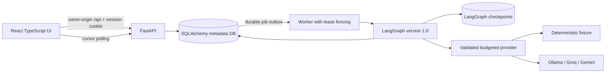
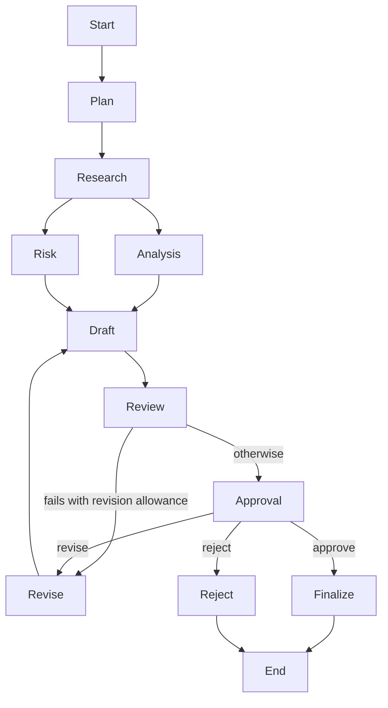
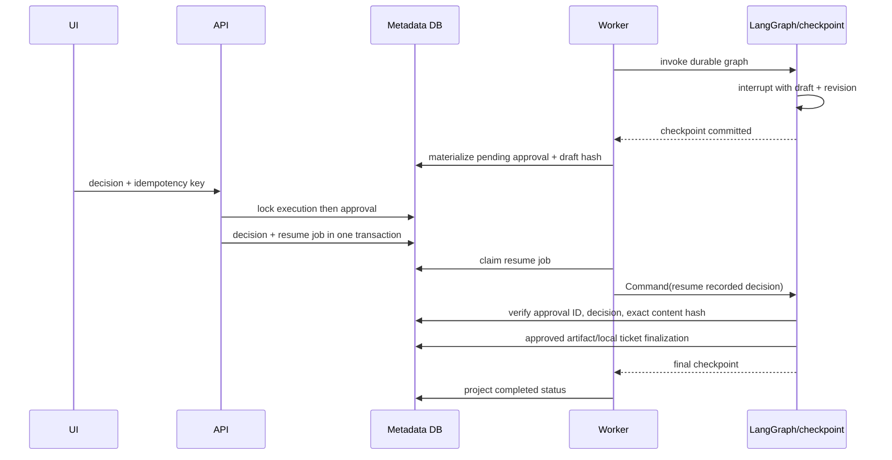
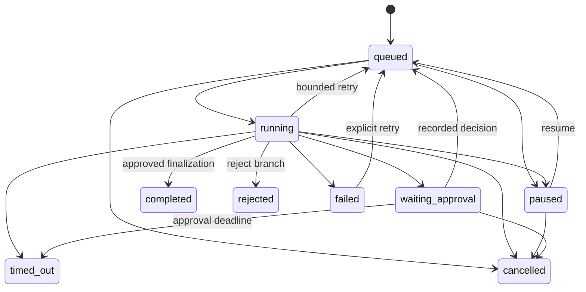

# Architecture

Relay separates user/API operations, durable scheduling, graph execution, and model calls. This keeps approval waits out of request lifetimes and makes restart behavior inspectable.

Local metadata/checkpoints use separate SQLite files. SQLite metadata transactions use `BEGIN IMMEDIATE`, foreign keys, and WAL. PostgreSQL supports row-level job claiming with `FOR UPDATE SKIP LOCKED`; execution-level advisory locks prevent overlapping graph workers. SQLite uses per-execution file locks. Fenced lease tokens ensure an older claimant cannot project a newer job's results. Delivery is at least once; the implementation does not claim globally exactly-once model inference.

## Workflow graph

All three templates share graph version 1.0 and differ in objective, instructions, and support-ticket behavior. Templates describe the actual graph; arbitrary graph editing is not exposed.

Analysis and risk branch from research and join before draft. Review can route automatically through bounded revision. If allowance is exhausted, human approval still receives the review context; a review pass is not itself finalization authorization. A human revision also consumes the same configured allowance.

Each node checks lifecycle conditions, emits start/completion events, and creates an OpenTelemetry span. Handoff events contain a validated contract: workflow ID, current node, source/target agent, task, scoped context, output schema, timeout, permissions, and correlation ID. Handoffs expose operational context, not private chain-of-thought.

The provider validates Pydantic JSON outputs and research checks that cited quotations are literal substrings of selected source snapshots. Draft source IDs must stay within authorized evidence. These checks do not establish that every generated claim is semantically correct.

## Approval and persistence

The two stores do not participate in a distributed transaction. Ordering and reconciliation address the gap: approval materialization follows checkpoint persistence; completion follows committed graph state; recovery reads recorded decisions and existing artifacts. Missing checkpoints on resume/retry fail closed instead of silently beginning a new run. Artifact uniqueness per execution prevents repeated export insertion.

Pause is cooperative at node boundaries; cancellation blocks further guarded work and finalization but does not recall an already-sent model request. Terminal outcomes include completed, cancelled, rejected, and timed_out. Failed runs can retry from a valid checkpoint. Worker job retries and provider-call retries are separate bounds. The local worker main loop runs a claimed job in a spawned process and enforces a wall-clock deadline of max_run_seconds+10; timed-out work without a committed artifact is marked timed_out. Committed artifacts recover graph projection instead. Lambda uses its platform invocation deadline in addition to graph/provider limits.

## Data and interfaces

Metadata entities: Workspace, User, LoginSession, AccessCode, Execution, Job, Approval, Artifact, Event, Source, Ticket, and RateBucket. Workspaces scope user-visible records. Events have global monotonic integer IDs and execution-scoped cursor retrieval. Artifacts remain Markdown text in the metadata database, not S3. Ticket finalization updates a local row, not an external support system.

The frontend uses TanStack Query for server state, XYFlow for read-only topology, and incremental event cursor polling with deduplication. It calls a relative `/api` path. Browser/API same-origin routing is the supported public hosting design. Server settings are read-only in the UI.

CrewAI is an optional bounded researcher/critic collaboration inside the research node. LangGraph retains lifecycle, revision, approval, and persistence ownership. The separate MCP registry is an experimental administrator-configured retrieval adapter; it is not invoked by these workflows or exposed in the UI. Maintenance runs hourly in the local worker and during cloud dispatch, removes expired anonymous workspace data/checkpoints after one-hour grace, and prunes expired session/code/rate records. Permanent workspaces are retained.
