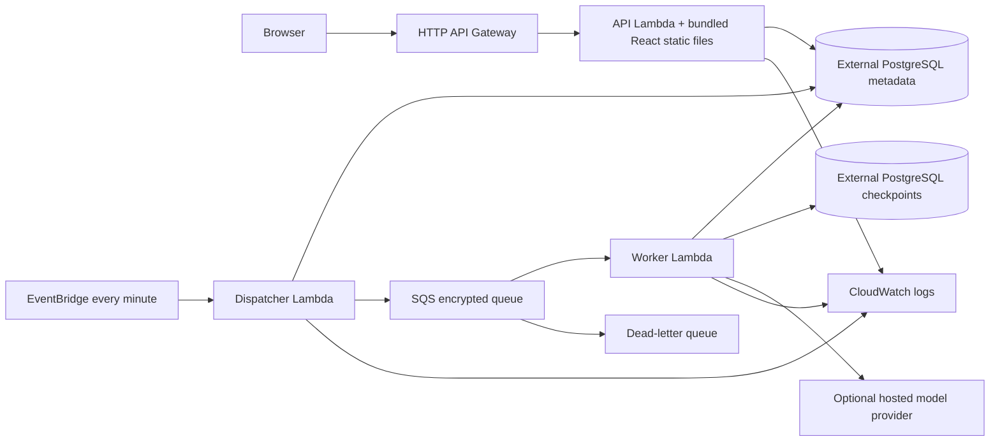

# Optional AWS architecture

`infra/aws/template.yaml` is an opt-in SAM deployment design. **No AWS resources were deployed or tested with account credentials during delivery.** The default `EnableResources=false` condition disables every declared resource. Packaging/building can still require Docker and image storage; a disabled application stack is not a promise that surrounding tooling is free.



## Implemented assets

The Lambda container performs a Node/pnpm frontend build and bundles its static output. `RELAY_STATIC_DIR` enables the API's final static-files mount. The HTTP API exposes `/` and the catch-all route. Open the resulting `ApiUrl` root as the application URL: frontend and `/api` share the same origin, which is compatible with the HttpOnly/SameSite=Lax session cookie. Hosting a separate frontend requires an equivalent same-origin proxy rather than relying on cross-site cookies.

The API writes jobs to PostgreSQL in the same transaction as execution or decision updates. A scheduled dispatcher scans queued or lease-expired jobs and sends job IDs to SQS. Send happens before marking dispatch: a crash can duplicate delivery, so claim fencing, execution locks, checkpoint recovery, and artifact uniqueness remain required. The database outbox is authoritative; queue messages are delivery triggers.

The worker processes SQS records with partial batch failure reporting. Each invocation claims a durable job and runs the graph against PostgreSQL checkpoints. It rejects SQLite for cloud metadata/checkpoints. API/dispatcher Lambdas default to 512 MB/30 seconds; the worker is 1024 MB/300 seconds. Reserved concurrency is API2/worker2/dispatcher1; SQS event concurrency is2 and batch size1. Queue visibility is1800 seconds, retention1day, DLQ retention4days, redrive count3. These are configured bounds, not measured throughput.

CloudWatch log retention is7days. API Gateway config limits burst10 and sustained5 requests/second. Template execution allowances are3/workspace and20/global/day. None of these is a financial hard cap.

## Required external decisions

The template does not create PostgreSQL, frontend CDN, database backups, private networking, a database proxy, secret rotation, WAF, custom domain, or budget alarms. Supply persistent PostgreSQL connection URLs for metadata and checkpoints, ensure connectivity from Lambda, and test SSL/pooling/concurrency behavior. PostgreSQL and checkpoints can use different databases; preserve both consistently.

`DatabaseUrl`, `CheckpointUrl`, and `ModelApiKey` are NoEcho parameters. NoEcho reduces console display exposure; it is not a managed-secret lifecycle. Functions receive values in environment variables. A production design should decide how to source/rotate secrets and restrict deployment permissions. The live-provider choices in SAM are fixture/Groq/Gemini; no Ollama server or GPU is provisioned. CrewAI is not installed in the supplied Lambda image.

## Review and deployment procedure

First inspect account eligibility, current service pricing, ECR/image charges, database charges, quotas, region availability, and an independent spend-control plan. No current price or free-tier guarantee is embedded here.

```powershell
sam validate --lint --template-file infra/aws/template.yaml
sam build --template-file infra/aws/template.yaml
sam deploy --guided
```

These are operator commands, not commands executed during delivery. Keep `EnableResources=false` until the external persistence, secret handling, quotas, and budget controls have been reviewed. When deliberately enabling resources, supply the actual connection parameters rather than empty defaults. `FrontendOrigin` is an additional allowed origin for proxy/custom-origin scenarios; serving from `ApiUrl` itself satisfies the same-origin check.

After deployment, verify root/static loading, secure cookies, health, outbox dispatch, approval expiry, recovery, and a complete fixture smoke execution. Review logs and queue/DLQ behavior before enabling live inference. Follow [COST_AND_LIMITS.md](COST_AND_LIMITS.md). Delete the stack and inspect external databases, ECR images, logs, and other independently provisioned resources when retiring the experiment; deleting SAM resources does not establish that all account charges have stopped.
