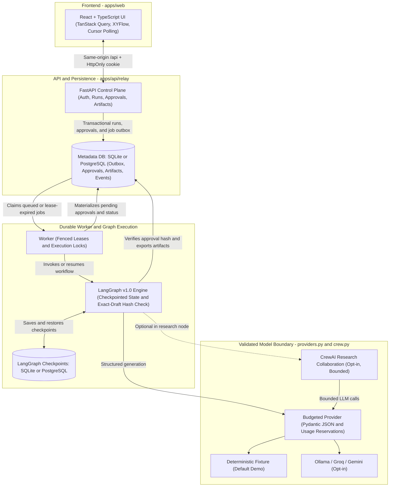
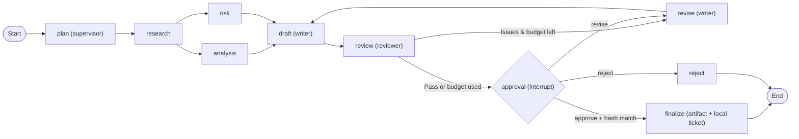

# Relay

Relay is a human-supervised workflow operations application. It turns a brief and reference documents into a traceable research report, support response draft, or reviewed content artifact. LangGraph controls durable execution; people approve the exact draft before finalization.

The default experience is an explicitly labeled **deterministic integration demo**. It exercises persistence, branching, approval, revisions, and export without model inference or paid credentials. Live providers and bounded CrewAI research are opt-in.

## Architecture

Relay separates the browser UI, FastAPI control plane, durable job outbox, LangGraph checkpointed execution, and validated model calls so human approval pauses never tie up HTTP requests or worker processes.

### System overview



### Workflow and approval pipeline

All workflow templates execute on versioned LangGraph `1.0` with parallel `analysis` and `risk` branches, bounded revision loops, and an `interrupt()` gate that requires an exact-draft hash match before finalization:



Runs locally with SQLite (`scripts/dev.ps1`), via Docker Compose + PostgreSQL ([compose.yaml](compose.yaml)), or through the opt-in AWS SAM serverless path ([AWS_ARCHITECTURE.md](AWS_ARCHITECTURE.md)). See [ARCHITECTURE.md](ARCHITECTURE.md) for the approval sequence diagram, execution state machine, and locking details.

## Start locally on Windows

Prerequisites: Python 3.13 (package supports 3.12–3.13), uv, Node 24, and pnpm 10.24.0. From the repository root:

```powershell
Copy-Item .env.example .env
uv sync --frozen
pnpm.cmd --dir apps/web install --frozen-lockfile
```

Run each service in a separate PowerShell terminal:

```powershell
./scripts/dev.ps1 api
./scripts/dev.ps1 worker
./scripts/dev.ps1 web
```

Open http://localhost:5173 and choose **Try demo workspace**. Open Workflows, choose a template, run it, review the pending approval, then download the approved Markdown artifact. The API is at http://localhost:8000; its interactive reference is `/docs`. The API alone does not execute jobs: the worker must run.

See [SETUP.md](SETUP.md) for private workspace sign-in, provider configuration, and runtime details.

CrewAI is optional (`uv sync --frozen --extra crew`). Review its transitive dependency advisories in [SECURITY.md](SECURITY.md) before enabling it; the default runtime and container images exclude this extra.

## What is implemented

- React/TypeScript workspace: overview, templates/topology, controlled configuration, source upload, execution search, live event polling, approvals, artifacts, agents, analytics, and light/dark appearance.
- Versioned LangGraph workflow with parallel analysis/risk branches, structured handoffs, review/revision loops, durable approval interruption, and resume.
- Database-backed job outbox, fenced leases, execution locks, bounded retries, checkpoint recovery, and workspace-scoped data access.
- Exact-draft approval hashes; final artifact/ticket changes require a recorded approval. Support tickets remain local records; no email or external customer action is sent.
- Server-assigned roles and short-lived, one-time administrator-issued access codes. Demo workspaces are isolated and expire.
- Validated provider boundary for Ollama, Groq, and Gemini; conservative usage reservations and optional explicitly configured fallback.
- Docker Compose/PostgreSQL and an opt-in AWS SAM API/worker/dispatcher template.

## Verification and scope

Frontend type checking, production build, four unit tests, and two Chromium integration tests passed locally. The browser tests cover demo → workflow → approval → downloadable artifact and mobile/light-theme navigation. Access-code browser testing is optional and was skipped without a provisioned test code. Backend coverage and the current check results are described in [TESTING.md](TESTING.md).

No live provider result, production load result, AWS deployment, or remote CI success is claimed. Docker was not running in the delivery environment. The optional MCP adapter is not connected to the application workflow/UI. See [EVALUATION.md](EVALUATION.md) for the capability matrix.

## Guide

| Document | Purpose |
| --- | --- |
| [ARCHITECTURE.md](ARCHITECTURE.md) | Components, graph, persistence, approval protocol |
| [API_REFERENCE.md](API_REFERENCE.md) | Requests, permissions, errors, idempotency |
| [DEPLOYMENT.md](DEPLOYMENT.md) | Containers, same-origin hosting, operations |
| [AWS_ARCHITECTURE.md](AWS_ARCHITECTURE.md) | Optional cloud path and missing deployment prerequisites |
| [COST_AND_LIMITS.md](COST_AND_LIMITS.md) | Usage budgets and cost boundaries |
| [SECURITY.md](SECURITY.md) | Threat model, authentication, trust boundaries |
| [TESTING.md](TESTING.md) | Local commands, test scope, CI definition |
| [TROUBLESHOOTING.md](TROUBLESHOOTING.md) | Common failures and recovery |
| [RESUME_AND_PORTFOLIO.md](RESUME_AND_PORTFOLIO.md) | Honest demonstration and résumé wording |

This repository does not currently include a license file. Do not infer an open-source license from public availability.
